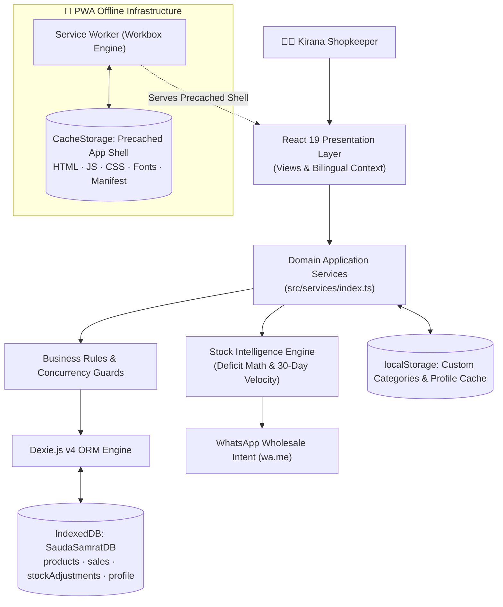
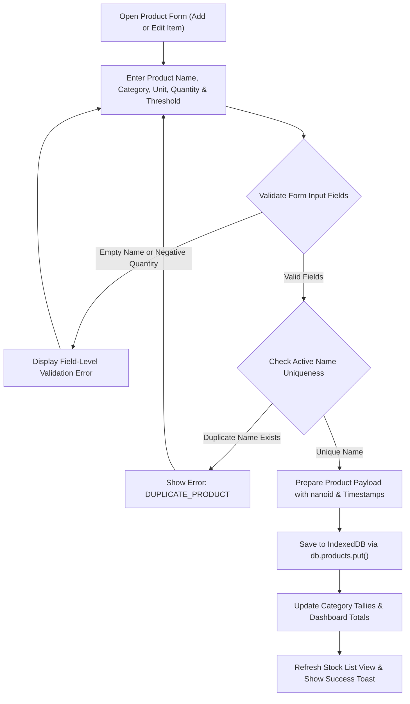
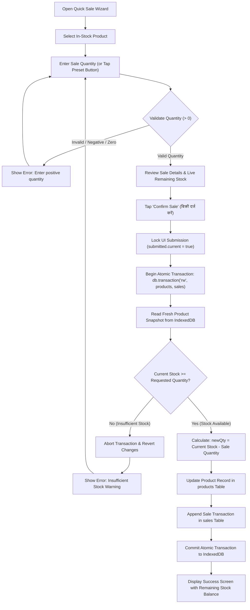
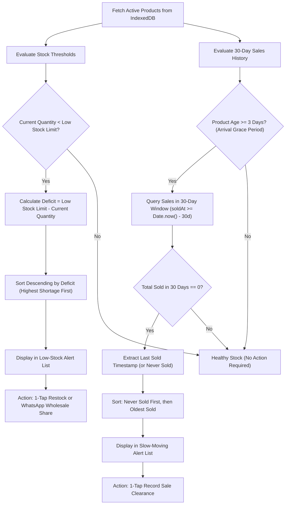
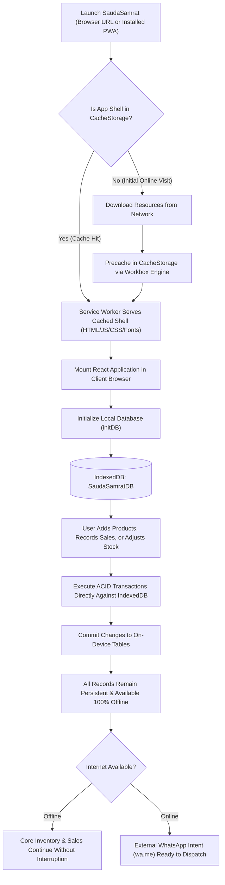
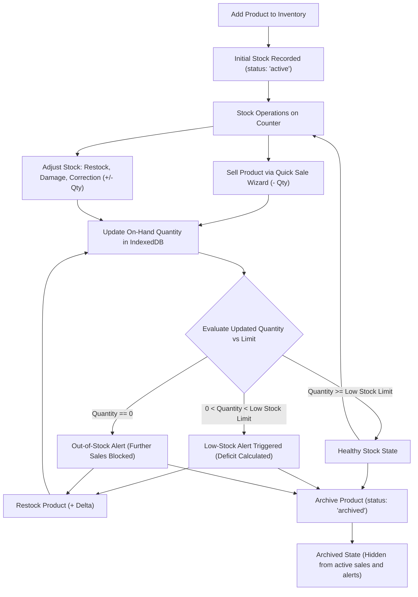
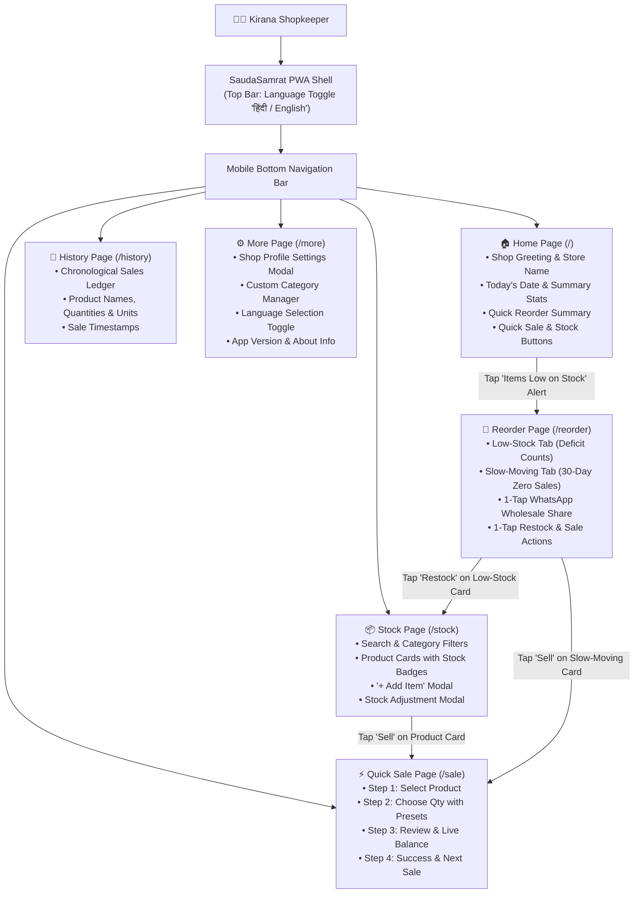

# 🛒 SaudaSamrat (सौदा सम्राट)
### दुकानदार का स्मार्ट ऑफलाइन साथी · A practical inventory companion for neighborhood retailers

**Know what you have. Spot what needs attention. Restock with confidence.**

SaudaSamrat is a mobile-first, offline-first Progressive Web App (PWA) designed to make everyday stock management simpler for small Indian retailers. It focuses on product inventory, quick sale recording, low-stock visibility, slow-moving products, and a Hindi/English interface—without requiring a cloud account or a continuously available internet connection for core local workflows.

> **Product focus:** SaudaSamrat is an inventory and restocking assistant—not a full billing, accounting, or GST invoicing platform.

<p align="center">
  <strong>Built for everyday shop operations · Designed for touch · Ready for offline use</strong>
</p>

<p align="center">
  <a href="https://react.dev/"></a>
  <a href="https://www.typescriptlang.org/"></a>
  <a href="https://vite.dev/"></a>
  <a href="https://tailwindcss.com/"></a>
  <a href="https://dexie.org/"></a>
  <a href="https://web.dev/progressive-web-apps/"></a>
  <a href="https://vitest.dev/"></a>
  <a href="LICENSE"></a>
</p>

---

## 📌 Contents

- [🌱 Why SaudaSamrat?](#-why-saudasamrat)
- [🎯 How We Address the Kirana Problem](#-how-we-address-the-kirana-problem)
- [✨ Feature Overview](#-feature-overview)
- [🎨 Visual Design & Theme System](#-visual-design--theme-system)
- [🏗️ Architecture at a Glance](#%EF%B8%8F-architecture-at-a-glance)
  - [Architectural Layers & Responsibilities](#architectural-layers--responsibilities)
  - [1. System Architecture](#1-system-architecture)
- [🔄 Core Workflows & Visual Diagrams](#-core-workflows--visual-diagrams)
  - [2. Add or Update Product Workflow](#2-add-or-update-product-workflow)
  - [3. Quick Sale Workflow (Atomic Concurrency Protection)](#3-quick-sale-workflow-atomic-concurrency-protection)
  - [4. Low Stock and Slow-Moving Workflow](#4-low-stock-and-slow-moving-workflow)
  - [5. Offline-First Workflow](#5-offline-first-workflow)
  - [6. Inventory Lifecycle Workflow](#6-inventory-lifecycle-workflow)
  - [7. Application Navigation Architecture](#7-application-navigation-architecture)
- [🛠️ Technology Stack](#%EF%B8%8F-technology-stack)
- [🗄️ Database Schema & Local Storage](#%EF%B8%8F-database-schema--local-storage)
- [📁 Project Structure](#-project-structure)
- [🚀 Getting Started](#-getting-started)
- [📲 Installing the PWA](#-installing-the-pwa)
- [📴 Offline-First Design](#-offline-first-design)
- [🧪 Testing and Quality](#-testing-and-quality)
- [🔐 Privacy, Safety and Limitations](#-privacy-safety-and-limitations)
- [🗺️ Roadmap](#%EF%B8%8F-roadmap)
- [🤝 Contributing](#-contributing)
- [📄 License](#-license)
- [🌾 Our Vision](#-our-vision)

---

## 🌱 Why SaudaSamrat?

Neighborhood retailers across India often manage hundreds of products using memory, notebooks, or disconnected manual processes. The result is familiar to every shopkeeper: missing stock during rush hours, over-ordering slow products, tied-up working capital, and stressful calculations.

Many traditional digital tools fail in this environment because they assume reliable broadband, expensive desktop hardware, or enterprise workflows filled with confusing jargon.

SaudaSamrat focuses strictly on the everyday questions that matter at the counter:

- **What products do I have on hand?**
- **Which products are running low and need reordering?**
- **Which products have stopped moving over the last 30 days?**
- **How can I record a counter sale in 3 seconds without a lengthy billing form?**
- **Can I continue working seamlessly when the mobile signal drops?**

The goal is not to add administrative burden. It is to make stock information effortless to maintain, dependable to review, and actionable to restock.

---

## 🎯 How We Address the Kirana Problem

| Real-world Kirana Challenge | SaudaSamrat Approach | Practical Value | Verified Codebase Implementation |
| :--- | :--- | :--- | :--- |
| **Stock is tracked in memory or paper "khata"** | Structured, searchable local product catalog | Clear, instant view of recorded stock by category | `src/services/index.ts` (`getProducts`, `addProduct`) |
| **Popular daily staples run out unexpectedly** | Configurable stock thresholds & dedicated Low Stock list | Early restocking decisions before shelves are empty | `getLowStockProducts()` computes $\text{Deficit} = \text{Limit} - \text{Stock}$ |
| **Dead stock sits unnoticed, trapping capital** | Rolling 30-day sales velocity audit with 3-day arrival grace | Clear visibility into stagnant inventory needing clearance | `getSlowMovingProducts({ lookbackDays: 30 })` |
| **Counter sale recording takes too many taps** | 3-step Quick Sale wizard with one-touch unit presets | Fast checkout with minimal taps during peak hours | `src/pages/SalePage.tsx` with dynamic `UNIT_PRESETS` |
| **Accidental double-taps cause phantom stock** | UI-level debouncing and atomic IndexedDB transactions | Guaranteed stock consistency; rejects overselling | `db.transaction('rw', db.products, db.sales)` |
| **Spelling errors create duplicate entries** | Dropdowns for 9 standard categories and 8 units | Consistent records and clean category filtering | `src/services/categories.ts` & `getCategoryOptions` |
| **Dense indoor market lanes have poor connectivity** | Precached PWA shell and on-device IndexedDB persistence | Complete inventory and sales workflows work 100% offline | `vite.config.ts` Workbox cache + `Dexie.js` |
| **Technical English jargon alienates shop owners** | 100% bilingual parity (हिंदी + English) with relatable terms | Immediate adoption without training or computer literacy | `src/i18n/labels.ts` and `LangContext.tsx` |

> *SaudaSamrat is designed to improve visibility and eliminate manual guesswork. Its practical impact comes from simple, dependable software that respects how neighborhood storekeepers actually work.*

---

## ✨ Feature Overview

### 📦 Inventory Essentials
- **Add, Edit, Adjust & Archive:** Full CRUD operations for products with instant visual feedback.
- **Categorization:** Select from 9 standard Indian retail categories (*Grocery, Dairy, Snacks, Beverages, Personal Care, Household, Stationery, Medicines, Other*) or create custom categories.
- **Legacy Category Preservation:** Existing categories from past records are automatically preserved and never hidden or lost.
- **Retail Units:** Full support for 8 everyday retail units: `piece`, `packet`, `bottle`, `kg`, `g`, `litre`, `ml`, and `dozen`.
- **Decimal Precision:** Normalized calculation (`+(val).toFixed(6)`) prevents floating-point inaccuracies on fractional stock (e.g. `0.25 kg`, `1.5 L`).
- **Audit Adjustments:** Record ad-hoc corrections with reason tagging (`manual_correction`, `restock`, `damage`, `return`) and optional notes.

### ⚡ Quick Sale Counter Wizard
- **3-Step Flow:** *Select Item $\rightarrow$ Choose Quantity $\rightarrow$ Review & Confirm*.
- **One-Thumb Presets:** Pre-calculated increment buttons tailored to the active unit:
  - Countable goods (`piece`, `packet`, `bottle`): `+1`, `+2`, `+5`, `+10`
  - Fractional bulk goods (`kg`, `litre`): `+0.25`, `+0.5`, `+1`, `+2`
  - Granular weight/volume (`g`, `ml`): `+50g`, `+100g`, `+250g`, `+500g`
  - Dozen goods (`dozen`): `+0.5`, `+1`, `+2`, `+5`
- **Dynamic Stock Ceiling:** Increment buttons that would cause overselling are automatically disabled.
- **Live Remaining Balance Preview:** Immediate visual verification of the remaining balance before committing.
- **Atomic Overselling Protection:** Rejects negative, zero, or excessive sale quantities at the database transaction layer.

### 🚦 Actionable Inventory Insights
- **Low Stock:** Flags products where $\text{Quantity} < \text{Low Stock Limit}$ and computes the exact replenishment deficit:
  $$\text{Deficit} = \text{Low Stock Threshold} - \text{Current Stock}$$
- **Slow-Moving Goods:** Surfaces products with 0 sales in the past 30 days. Includes an automatic 3-day grace period for newly added inventory so new items are not prematurely flagged.
- **Clear Distinction:** Low-stock and slow-moving items are kept strictly separated so fast-selling items are never confused with stagnant stock.
- **1-Tap WhatsApp Wholesale Sharing:** Compiles an organized replenishment list with localized Hindi or English copy, launched via direct WhatsApp URL intent (`https://wa.me/?text=...`).

### 🏪 Shop Profile & Bilingual Localization
- **Personalized Greeting:** Extracts the owner's first name and displays a warm greeting banner (e.g., *"नमस्ते, राहुल जी! 🙏"* or *"Namaste, Rahul ji! 🙏"*).
- **Honorific De-duplication:** Prevents duplicate suffixes like *"Rahul ji ji"*.
- **Read-Only Home Dashboard:** Shop profile customization is safely isolated inside **Settings > Shop Profile**, keeping Home focused on quick stats and actions.
- **Instant Language Switching:** Top-bar toggle between **हिंदी** and **English** with complete dictionary coverage across buttons, categories, units, and errors.

### 📱 Progressive Web App (PWA)
- **Installable Everywhere:** Add to home screen on Android, iOS, or desktop without app store friction.
- **Precached App Shell:** Service worker precaches HTML, JavaScript, CSS, fonts, and web manifest.
- **Local-First Persistence:** IndexedDB stores all business data directly on the client device.

> **Feature honesty:** Barcode scanning, batch expiry tracking, and encrypted cloud backup are intentionally classified as future roadmap items. SaudaSamrat does not claim features that are not verified in the active repository.

---

## 🎨 Visual Design & Theme System

SaudaSamrat uses the custom **Fresh Indian Retail** design system built on Tailwind CSS v4. Inspired by Indian retail markets, natural turmeric, mint leaves, and clean ledger paper, the interface provides high contrast and reduced eye fatigue under harsh shop lighting:

| Design Token | Hex Code | Purpose & Semantic Application |
| :--- | :--- | :--- |
| `--color-primary` | `#218653` | Brand green; primary CTA buttons, active tabs, checkout confirmations |
| `--color-primary-dark` | `#176640` | Deep emerald green; text emphasis, category badges, section titles |
| `--color-mint` | `#DDF5E5` | Soft mint focus rings and subtle container fills |
| `--color-tile-mint` | `#E8F8EE` | Card backgrounds, icon circles, and success feedback tiles |
| `--color-lemon` | `#FFF2B8` | Warm lemon yellow; low-stock warning chips and alerts |
| `--color-warm-bg` | `#FAFCF8` | Warm off-white canvas reducing counter glare |
| `--color-main-text` | `#20332A` | Deep slate-forest for high-contrast sunlight readability |
| `--color-secondary-text` | `#6B7B70` | Olive-gray for units, metadata, and timestamps |
| `--color-subtle-border` | `#E5ECE5` | Crisp card borders and divider lines |
| `--color-coral` | `#DC2626` | Out-of-stock indicators, deficit warnings, and destructive actions |

- **Touch Ergonomics:** All buttons, presets, and select boxes maintain touch targets of $\ge 44\text{px}$ to $56\text{px}$ for comfortable one-handed use on mobile counters.
- **Mobile Keypads:** Number inputs trigger numeric decimal keyboards (`inputMode="decimal"`) with native browser spinner arrows removed.

---

## 🏗️ Architecture at a Glance

SaudaSamrat follows a **local-first, offline-first** architecture. The React application runs entirely in the browser. Application services mediate between the UI and local persistence, enforcing validation rules and atomic transactions before records touch IndexedDB via Dexie.js.

### Architectural Layers & Responsibilities

| Layer | Component | Responsibility |
| :--- | :--- | :--- |
| **Presentation** | React 19 + TypeScript + Tailwind v4 | Renders screens, captures touch events, and maintains responsive UI state. |
| **Localization** | `LangContext` (`src/i18n/`) | Provides instant synchronous switching between Hindi and English dictionaries. |
| **Service Layer** | Application Services (`src/services/`) | Centralizes domain operations: product management, sales, adjustments, and profile settings. |
| **Business Logic** | Validation & Concurrency Rules | Enforces non-negative stock guards, duplicate name rejection, and decimal precision. |
| **Transaction Boundary** | Dexie.js v4 (`src/db/`) | Coordinates multi-table ACID transactions (`db.transaction('rw', ...)`) ensuring stock balances and sale records never diverge. |
| **Local Persistence** | IndexedDB (`SaudaSamratDB`) | On-device persistent storage for products, sales, stock adjustments, and profile records. |
| **Offline Engine** | Service Worker (Workbox) | Precaches the application shell (HTML, CSS, JS, fonts, manifest) for zero-network startup. |

> **Important distinction:** The Service Worker caches **application resources**; IndexedDB stores **shop data**. These are two distinct browser mechanisms that work together to deliver an offline-first experience.

---

### 1. System Architecture

The following diagram illustrates how the React 19 UI communicates with the domain services, how business rules and concurrency guards validate requests before invoking atomic Dexie.js transactions, and how persistent IndexedDB storage is maintained separately from the offline PWA service worker cache:



---

## 🔄 Core Workflows & Visual Diagrams

### 2. Add or Update Product Workflow



Category selection eliminates misspelled free-text entries. When custom categories are created or past products with legacy categories are loaded, SaudaSamrat automatically preserves them so past records are never obscured.

---

### 3. Quick Sale Workflow (Atomic Concurrency Protection)

To guarantee that inventory numbers never drift into negative values during fast counter rushes, SaudaSamrat wraps all sale operations inside an atomic read-write Dexie transaction with pre-decrement verification:



The stock check happens **inside** the database transaction. A disabled UI button alone is never treated as sufficient concurrency protection against rapid double-taps.

---

### 4. Low Stock and Slow-Moving Workflow



- **Low Stock:** Alerts shopkeepers when items fall strictly below their threshold, ranking the most critical shortages first.
- **Slow Moving:** Detects products with 0 sales over 30 days while protecting newly arrived stock with an automatic 3-day grace period.

---

### 5. Offline-First Workflow



---

### 6. Inventory Lifecycle Workflow



---

### 7. Application Navigation Architecture

SaudaSamrat organizes its mobile-first interface into 6 primary views accessible via the bottom navigation bar and reactive contextual shortcuts:



---

## 🛠️ Technology Stack

| Technology | Version | Purpose in SaudaSamrat |
| :--- | :--- | :--- |
| **React** | `^19.3.1` | Component-based user interface with concurrent rendering |
| **TypeScript** | `~6.0.3` | End-to-end static type safety across data models, services, and props |
| **Vite** | `^8.3.4` | Ultra-fast local development server, ES module bundling, and PWA plugin host |
| **Tailwind CSS** | `^4.0.0` | Custom Fresh Indian Retail design system tokens and high-performance styling |
| **Dexie.js** | `^4.4.6` | Minimalist, type-safe wrapper for browser IndexedDB with ACID transactions |
| **IndexedDB** | Native | W3C standard on-device persistent database for durable retail records |
| **vite-plugin-pwa** | `^0.21.1` | Automated Workbox service worker generation, manifest injection, and precaching |
| **Lucide React** | `^1.61.0` | Clean, touch-friendly retail iconography |
| **Vitest** | `^3.2.4` | High-speed unit and integration test runner |
| **fake-indexeddb** | `^6.2.6` | In-memory IndexedDB simulation for automated tests |
| **Oxlint** | `^1.88.0` | Rust-based high-speed static code analysis |

---

## 🗄️ Database Schema & Local Storage

All operational data is persisted on the user's device in an IndexedDB database named **`SaudaSamratDB`**.

### Dexie Database Versioning (`src/db/index.ts`)

```ts
class SaudaSamratDB extends Dexie {
  products!: Table<Product, string>;
  sales!: Table<Sale, string>;
  stockAdjustments!: Table<StockAdjustment, string>;
  profile!: Table<ShopProfile, string>;

  constructor() {
    super('SaudaSamratDB');

    // Version 1 — Core inventory & sales engine
    this.version(1).stores({
      products: 'id, name, category, status, updatedAt',
      sales: 'id, productId, soldAt',
      stockAdjustments: 'id, productId, adjustedAt',
    });

    // Version 2 — Persistent shop profile settings
    this.version(2).stores({
      profile: 'id',
    });
  }
}
```

### Table Definitions & Entity Schemas

#### 1. `products` Table
| Field | Type | Description | Indexing |
| :--- | :--- | :--- | :--- |
| `id` | `string` | Unique identifier generated via lightweight `nanoid` | Primary Key |
| `name` | `string` | Product name (e.g., *"Toor Dal 1kg"*, *"Amul Butter 500g"*) | Indexed |
| `category` | `string` | Default category key (e.g. `'grocery'`) or custom string | Indexed |
| `quantity` | `number` | Current on-hand quantity (normalized to 6 decimal places) | Non-indexed |
| `unit` | `Unit` | `'piece' \| 'packet' \| 'bottle' \| 'kg' \| 'g' \| 'litre' \| 'ml' \| 'dozen'` | Non-indexed |
| `lowStockThreshold`| `number` | Minimum stock limit triggering low-stock alert | Non-indexed |
| `status` | `ProductStatus` | `'active' \| 'archived'` | Indexed |
| `createdAt` | `number` | Epoch timestamp in milliseconds | Non-indexed |
| `updatedAt` | `number` | Epoch timestamp in milliseconds | Indexed |

#### 2. `sales` Table
| Field | Type | Description | Indexing |
| :--- | :--- | :--- | :--- |
| `id` | `string` | Unique sale transaction ID | Primary Key |
| `productId` | `string` | Foreign key referencing `products.id` | Indexed |
| `productName` | `string` | Denormalized snapshot of product name at sale time | Non-indexed |
| `quantity` | `number` | Quantity sold in this transaction | Non-indexed |
| `unit` | `Unit` | Snapshot of product unit at sale time | Non-indexed |
| `soldAt` | `number` | Epoch timestamp in milliseconds | Indexed |

#### 3. `stockAdjustments` Table
| Field | Type | Description | Indexing |
| :--- | :--- | :--- | :--- |
| `id` | `string` | Unique adjustment log ID | Primary Key |
| `productId` | `string` | Foreign key referencing `products.id` | Indexed |
| `delta` | `number` | Quantity change: positive for additions, negative for deductions | Non-indexed |
| `reason` | `StockAdjustmentReason` | `'manual_correction' \| 'restock' \| 'damage' \| 'return'` | Non-indexed |
| `note` | `string?` | Optional shopkeeper memo explaining the adjustment | Non-indexed |
| `adjustedAt` | `number` | Epoch timestamp in milliseconds | Indexed |

#### 4. `profile` Table
| Field | Type | Description | Indexing |
| :--- | :--- | :--- | :--- |
| `id` | `'profile'` | Singleton key ensuring a single profile record | Primary Key |
| `ownerName` | `string` | Retailer's full name (e.g., *"Rahul Sharma"*) | Non-indexed |
| `shopName` | `string` | Store banner name (e.g., *"Sharma General Store"*) | Non-indexed |
| `updatedAt` | `number` | Epoch timestamp in milliseconds | Non-indexed |

#### 5. LocalStorage Keys
- **`ss_custom_categories`:** JSON array of retailer-defined custom categories (e.g. `["Puja Samagri", "Spices"]`) for instant synchronous hydration.
- **`ss_shop_name` & `ss_owner_name`:** Secondary cache enabling immediate synchronous rendering of top bar headers before the asynchronous IndexedDB database completes initialization.

---

## 📁 Project Structure

```text
SaudaSamrat/
├── public/
│   ├── favicon.svg               # Application browser favicon
│   ├── icons.svg                 # Shared SVG icon spritesheet
│   ├── manifest.webmanifest      # PWA web app manifest (name, theme, icons)
│   └── icons/
│       ├── icon-192.png          # Standard PWA launcher icon (192x192)
│       ├── icon-512.png          # High-resolution PWA splash icon (512x512)
│       └── apple-touch-icon.png  # Apple iOS home screen touch icon
├── src/
│   ├── app/
│   │   └── App.tsx               # Root app component, routing & DB lifecycle init
│   ├── components/
│   │   ├── Badge.tsx             # Semantic status pills (low stock, out of stock)
│   │   ├── BottomNav.tsx         # Mobile bottom navigation bar with active highlights
│   │   ├── Button.tsx            # Accessible, touch-friendly primary & secondary buttons
│   │   ├── ConfirmDialog.tsx     # Modal dialog for confirming destructive actions
│   │   ├── Input.tsx             # Text inputs, number inputs & styled selects
│   │   ├── Modal.tsx             # Accessible backdrop & modal dialog wrapper
│   │   ├── ProductCard.tsx       # Stock item card with category & quantity indicators
│   │   ├── ProductForm.tsx       # Form for adding and updating inventory items
│   │   ├── ProfileModal.tsx      # Modal for editing shopkeeper & store names
│   │   ├── StockAdjustForm.tsx   # Modal for logging manual stock adjustments
│   │   └── Toast.tsx             # Self-dismissing feedback notification toasts
│   ├── db/
│   │   └── index.ts              # Dexie database class, schema migrations & initDB
│   ├── hooks/
│   │   └── useDebounce.ts        # Custom hook for search input debouncing
│   ├── i18n/
│   │   ├── LangContext.tsx       # Language context provider with local storage persistence
│   │   └── labels.ts             # Complete bilingual Hindi & English translation dictionary
│   ├── pages/
│   │   ├── HistoryPage.tsx       # Chronological ledger of completed sales transactions
│   │   ├── HomePage.tsx          # Store dashboard, greeting banner & quick metrics
│   │   ├── MorePage.tsx          # Settings, Shop Profile, custom categories & language toggle
│   │   ├── ReorderPage.tsx       # Low-stock deficit alerts & slow-moving dead stock cards
│   │   ├── SalePage.tsx          # 3-step Quick Sale counter checkout wizard
│   │   └── StockPage.tsx         # Inventory list with search, filter chips & item actions
│   ├── services/
│   │   ├── categories.ts         # Default & custom category state and subscriber bus
│   │   ├── index.ts              # Domain business rules: products, sales, adjustments & profile
│   │   └── nanoid.ts             # Lightweight crypto-safe unique ID generator
│   ├── test/
│   │   ├── business_logic_audit.test.ts # 39 business logic and transaction tests
│   │   ├── categories.test.ts           # 16 category and unit tests
│   │   ├── offline_persistence.test.ts  # 3 database lifecycle & PWA manifest tests
│   │   ├── profile.test.ts              # 22 shop profile and greeting tests
│   │   ├── services.test.ts             # 9 service layer integration tests
│   │   ├── setup.ts                     # Test setup configuring fake-indexeddb
│   │   └── utils.test.ts                # 20 number, time, and formatting tests
│   ├── types/
│   │   └── index.ts              # Domain TypeScript interfaces, units & error types
│   ├── utils/
│   │   └── format.ts             # Quantity, currency, time & greeting helper functions
│   ├── index.css                 # Tailwind CSS v4 design tokens and base styles
│   └── main.tsx                  # React DOM root entry point & PWA registration
├── index.html                    # Root HTML document template
├── package.json                  # Project metadata, dependencies & scripts
├── package-lock.json             # Deterministic dependency lockfile
├── vite.config.ts                # Vite config & vite-plugin-pwa Workbox setup
├── vitest.config.ts              # Vitest test runner configuration
├── tsconfig.json                 # TypeScript compiler options
├── CONTRIBUTING.md               # Guidelines for contributing code and tests
├── LICENSE                       # MIT open-source license
└── README.md                     # Project documentation
```

---

## 🚀 Getting Started

### Prerequisites
- **Node.js:** Node.js `20.19+` or `22.12+` (required for Vite 8).
- **npm:** npm `10+` (bundled with Node.js).
- **Browser:** Modern evergreen desktop or mobile browser with IndexedDB support.

### 1. Clone the Repository
```bash
git clone https://github.com/tiwari-priyanshu05/SaudaSamrat.git
cd SaudaSamrat
```

### 2. Install Dependencies
```bash
npm install
```
*For automated CI environments, run `npm ci` for deterministic package installation.*

### 3. Start the Local Development Server
```bash
npm run dev
```
Open the local URL printed in the terminal (typically `http://localhost:5173/`).

### 4. Run Automated Tests
```bash
# Run all tests once
npm test

# Run tests in interactive watch mode
npm run test:watch

# Launch Vitest interactive browser UI
npm run test:ui
```

### 5. Run Typechecking & Linter
```bash
npm run typecheck
npm run lint
```

### 6. Build for Production
```bash
npm run build
```
Generates production-optimized assets and service worker precache files in the `dist/` directory.

### 7. Preview the Production Build Locally
```bash
npm run preview
```
Serves the production build (typically at `http://localhost:4173/`). Use this to test service worker caching, offline loading, and PWA installation prompts.

---

## 📲 Installing the PWA

SaudaSamrat can be installed through compatible browsers directly from the address bar:

### On Android (Chrome or Edge)
1. Open the application URL in Google Chrome.
2. Tap the browser overflow menu (**⋮**) or the install prompt banner.
3. Tap **Install app** or **Add to Home screen**.
4. The SaudaSamrat icon appears on your home screen and launches without browser address bar clutter.

### On Desktop (Chrome, Edge, or Brave)
1. Open the application URL in your desktop browser.
2. Click the **Install** computer icon located at the right end of the address bar.
3. Click **Install** to open SaudaSamrat in its own dedicated, native-like window.

### On iOS (Safari)
1. Open the application URL in Safari.
2. Tap the **Share** button (**⎋**).
3. Scroll down and tap **Add to Home Screen**.
4. Tap **Add** in the top-right corner.

> **PWA Installation Note:** Installing the PWA creates a convenient app-like launcher and precaches the web shell for offline startup. It does **not** create an online account or upload your inventory to a cloud server.

---

## 📴 Offline-First Design

SaudaSamrat maintains two distinct offline concerns:

1. **Application Resources (App Shell):**
   The service worker generated by Workbox precaches HTML, JavaScript bundles, CSS stylesheets, web manifest, and icons. This allows the application shell to load instantaneously even with zero connectivity.
2. **Shop Data (Business Records):**
   Products, sales transactions, stock adjustments, and shop profile settings are stored locally on the device in IndexedDB via Dexie.js.

### How to Verify Offline Behavior
1. Run `npm run build && npm run preview` to launch the production build.
2. Open `http://localhost:4173/` in Google Chrome.
3. Create a test product (e.g., *"Sugar 5kg"* with threshold 2) and record a test sale.
4. Open Chrome DevTools (**F12**) $\rightarrow$ **Application** $\rightarrow$ **Service Workers**.
5. Check the **Offline** checkbox (or toggle Network to Offline in the Network panel).
6. Reload the page (**Ctrl+R** / **Cmd+R**). The app shell loads smoothly and all stored inventory records remain intact.
7. Record another sale while offline, reload again, and confirm the new transaction and remaining stock persist.
8. Uncheck **Offline** to return to regular network mode.

> **Offline does not mean backed up.** Clearing browser/site data, uninstalling the browser, or browsing in private/incognito mode will permanently delete locally stored records. Cross-device sync and automatic cloud backup are intentionally not part of the current local-first architecture.

---

## 🧪 Testing and Quality

SaudaSamrat maintains a comprehensive automated testing suite executed through **Vitest** and **fake-indexeddb**. Every pull request is validated across business rules, precision math, atomic sales, and offline persistence.

### Verification Commands
```bash
npm test            # Run full test suite (109 tests)
npm run typecheck   # Validate TypeScript types (0 errors)
npm run lint        # Check static code quality with Oxlint (0 errors)
npm run build       # Validate production compilation & PWA precache
```

### Verified Test Suite Breakdown (109 Tests Passing)

```
✓ src/test/utils.test.ts (20 tests)
✓ src/test/services.test.ts (9 tests)
✓ src/test/offline_persistence.test.ts (3 tests)
✓ src/test/categories.test.ts (16 tests)
✓ src/test/profile.test.ts (22 tests)
✓ src/test/business_logic_audit.test.ts (39 tests)

Test Files  6 passed (6)
     Tests  109 passed (109)
```

| Test Suite File | Tests | Coverage & Scenarios Verified |
| :--- | :---: | :--- |
| **`business_logic_audit.test.ts`** | 39 | Product creation, duplicate name rejection, non-negative guards, stock adjustments, atomic sales decrements, zero/negative sale rejection, concurrent sales serialization, deficit math, and 30-day velocity audits with 3-day grace periods. |
| **`profile.test.ts`** | 22 | Shopkeeper name validation, length limits, whitespace trimming, first-name extraction (e.g. `"Rahul Sharma"` $\rightarrow$ `"Rahul"`), honorific de-duplication, and profile persistence across DB re-openings. |
| **`utils.test.ts`** | 20 | Number formatting, decimal precision rounding, unit abbreviation mappings, and localized relative time formatting (*"आज"*, *"कल"*, *"X दिन पहले"*). |
| **`categories.test.ts`** | 16 | 9 default categories, custom category addition and deduplication, legacy category retention from past products, and fractional calculations across all 8 retail units. |
| **`services.test.ts`** | 9 | Service-layer database initialization, active product queries, sales history sorting, and filter boundaries. |
| **`offline_persistence.test.ts`** | 3 | Verification of IndexedDB durability across connection cycles, service worker registration hooks, and web manifest consistency. |

---

## 🔐 Privacy, Safety and Limitations

### Data Ownership & Privacy
- **Zero Cloud Accounts or Telemetry:** No user registration, phone number, email, or password is collected.
- **No Remote Database:** Data is never transmitted to external cloud servers.
- **Client-Side WhatsApp Sharing:** Wholesale ordering works strictly through standard client-side URI intents (`https://wa.me/?text=...`). No contact books or store numbers are processed externally.

### Important Limitations
- **No Automatic Cloud Backup:** All data is confined to the local browser profile on the physical device.
- **Browser Cache Clearance:** Clearing browser cookies and site data will permanently delete stored inventory.
- **Private / Incognito Browsing:** Incognito tabs prevent durable persistence; records are erased when the session closes.
- **No Cross-Device Sync:** Data entered on one phone will not automatically sync to another phone or tablet.
- **Physical Device Access:** Anyone with unlocked physical access to the device can view inventory numbers. Store owners should maintain standard phone PIN or biometric screen locks.
- **Not a Fiscal Accounting Tool:** SaudaSamrat is an inventory and restocking assistant—not a full billing, GST tax invoicing, or profit-accounting platform.

---

## 🗺️ Roadmap

### ✅ Implemented & Verified in v1.0
- [x] Offline-first Progressive Web App with precached application shell.
- [x] On-device ACID persistence via IndexedDB and Dexie.js v4.
- [x] Complete inventory catalog with 9 retail categories and 8 physical units.
- [x] Fractional quantity support with 6-decimal precision rounding.
- [x] 3-step Quick Sale checkout wizard with unit presets and overselling guards.
- [x] Atomic transactions preventing inventory divergence during rapid counter sales.
- [x] Proactive Low-Stock intelligence with exact replenishment deficit calculations.
- [x] 30-day slow-moving dead stock detection with a 3-day arrival grace period.
- [x] 1-Tap formatted WhatsApp order dispatch with Hindi and English localization.
- [x] Full bilingual parity (Hindi + English) with instant top-bar switching.
- [x] Shop profile customization with automatic first-name greeting extraction.
- [x] 109 automated unit and integration tests passing in Vitest.

### 🔮 Proposed Roadmap

#### Phase 1: Data Safety & Portability
- [ ] **Validated Local Backup & Restore:** One-tap export of store records to a downloadable `.json` file, with schema validation on re-import to protect against accidental browser cache clears.
- [ ] **CSV / Excel Stock Export:** Export inventory and sales ledgers to standard CSV for offline bookkeeping.
- [ ] **Bulk Stock Receiving:** Multi-item checklist allowing shopkeepers to restock multiple incoming goods in a single session.

#### Phase 2: Counter Usability & Intelligence
- [ ] **Barcode-Assisted Lookup:** Camera-assisted barcode scanning (EAN-13/UPC) using the HTML5 Barcode Detection API.
- [ ] **Batch Expiry Tracking:** Optional expiry date recording with advance alerts for perishable dairy and packaged breads.
- [ ] **Favorites / Frequently Sold:** Quick-access shelf for high-velocity items during morning counter rushes.

#### Phase 3: Optional Secure Sync
- [ ] **End-to-End Encrypted Cloud Sync:** Optional, opt-in peer-to-peer or private cloud backup where only the merchant holds the decryption key.

---

## 🤝 Contributing

Contributions, bug reports, and usability feedback are warmly welcomed! Please read [`CONTRIBUTING.md`](CONTRIBUTING.md) for development conventions.

### Quick Workflow
1. Fork the repository and create your feature branch:
   ```bash
   git checkout -b feature/my-feature
   ```
2. Make small, focused changes adhering to project rules:
   - Keep business logic in `src/services/`.
   - Never call Dexie tables directly from React components.
   - Wrap multi-table updates in `db.transaction('rw', ...)`.
   - Add all user-facing strings to both `hi` and `en` in `src/i18n/labels.ts`.
3. Run the verification checklist:
   ```bash
   npm run typecheck && npm test && npm run lint && npm run build
   ```
4. Commit your changes and submit a pull request describing the problem solved.

---

## 📄 License

Distributed under the **MIT License**. See [`LICENSE`](LICENSE) for complete copyright terms.

---

## 🌾 Our Vision

Small retailers do not need software that creates more work. They need dependable, approachable tools that fit the natural rhythm of a busy neighborhood shop.

**SaudaSamrat** brings clarity to everyday inventory, makes restocking deliberate, and keeps local shop management resilient—even when the internet is not available.

<p align="center">
  <b>सौदासम्राट — छोटे व्यापारियों का सच्चा साथी 🇮🇳</b><br>
  <i>Made for neighborhood retail. Designed for everyday work. Built around reliable local data.</i>
</p>
