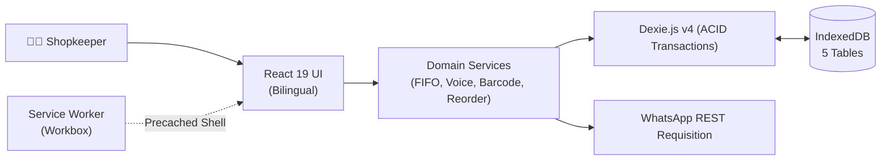
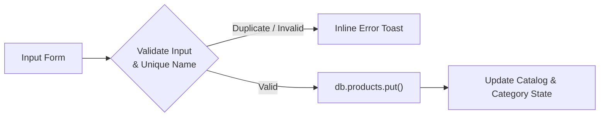
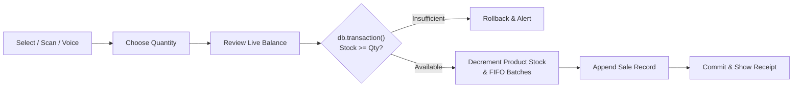
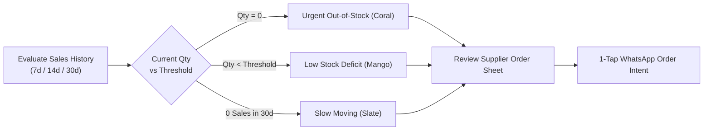
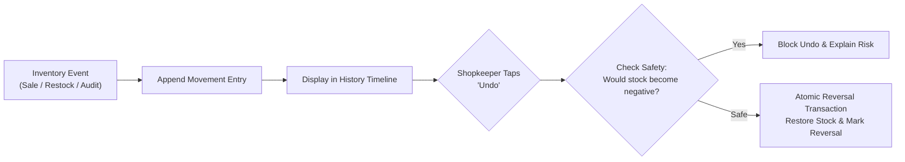
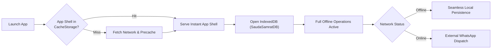
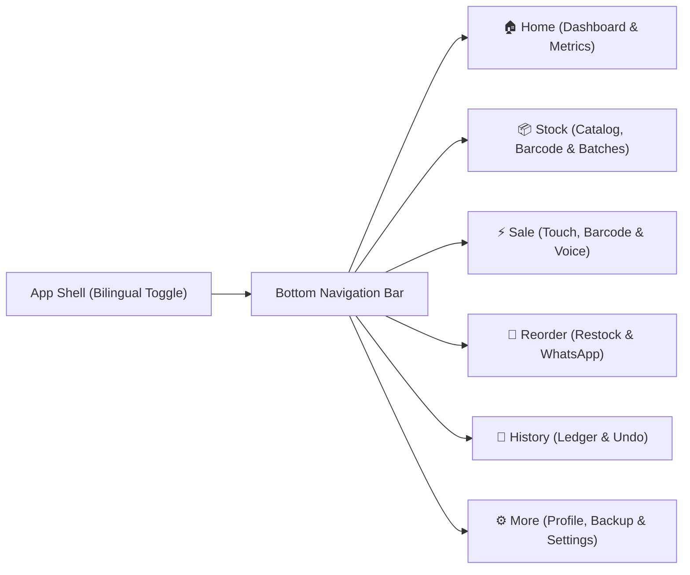

# 🛒 SaudaSamrat (सौदा सम्राट)
### दुकानदार का स्मार्ट ऑफलाइन साथी · A practical inventory companion for neighborhood retailers

**Know what you have. Spot what needs attention. Restock with confidence.**

SaudaSamrat is a mobile-first, offline-first Progressive Web App (PWA) designed to make everyday stock management simpler for small Indian neighborhood retailers. It combines instant inventory tracking, quick counter sales, low-stock run-rate intelligence, batch FIFO expiry tracking, camera barcode scanning, voice-assisted sales entry, movement history with safe undo, and one-tap WhatsApp supplier orders—with zero cloud lock-in, zero external server requirements, and 100% offline capability.

> **Product focus:** SaudaSamrat is an inventory and restocking assistant—not a full billing, accounting, or GST invoicing platform.

<p align="center">
  <strong>Built for everyday shop operations · Designed for touch · Ready for offline use</strong>
</p>

<p align="center">
  <a href="https://react.dev/"></a>
  <a href="https://www.typescriptlang.org/"></a>
  <a href="https://vite.dev/"></a>
  <a href="https://tailwindcss.com/"></a>
  <a href="https://dexie.org/"></a>
  <a href="https://web.dev/progressive-web-apps/"></a>
  <a href="https://vitest.dev/"></a>
  <a href="LICENSE"></a>
</p>

---

## 📌 Contents

- [🌱 Why SaudaSamrat?](#-why-saudasamrat)
- [🎯 Kirana Problem Matrix](#-kirana-problem-matrix)
- [✨ Core Capabilities](#-core-capabilities)
- [🎨 Modern Indian Retail Design System](#-modern-indian-retail-design-system)
- [🏗️ System Architecture](#%EF%B8%8F-system-architecture)
- [🔄 Streamlined Workflows & Compact Diagrams](#-streamlined-workflows--compact-diagrams)
  - [1. End-to-End System Architecture](#1-end-to-end-system-architecture)
  - [2. Add or Edit Product Workflow](#2-add-or-edit-product-workflow)
  - [3. Quick Sale & FIFO Batch Concurrency](#3-quick-sale--fifo-batch-concurrency)
  - [4. Smart Reorder & Supplier Requisition](#4-smart-reorder--supplier-requisition)
  - [5. Stock Movement Ledger & Safe Undo](#5-stock-movement-ledger--safe-undo)
  - [6. Offline-First PWA Lifecycle](#6-offline-first-pwa-lifecycle)
  - [7. Application Navigation Architecture](#7-application-navigation-architecture)
- [🛠️ Technology Stack](#%EF%B8%8F-technology-stack)
- [🗄️ Database Schema & Storage Versions](#%EF%B8%8F-database-schema--storage-versions)
- [📁 Project Directory Structure](#-project-directory-structure)
- [🚀 Getting Started](#-getting-started)
- [📲 Installing the PWA](#-installing-the-pwa)
- [📴 Offline-First Durability](#-offline-first-durability)
- [🧪 Testing and Quality Gates](#-testing-and-quality-gates)
- [🔐 Privacy and Limitations](#-privacy-and-limitations)
- [🗺️ Verified Enhancements & Roadmap](#%EF%B8%8F-verified-enhancements--roadmap)
- [🤝 Contributing](#-contributing)
- [📄 License](#-license)

---

## 🌱 Why SaudaSamrat?

Neighborhood retailers across India often manage hundreds of products using memory, notebooks, or disconnected manual processes. The result is familiar to every shopkeeper: missing stock during rush hours, over-ordering slow products, tied-up working capital, and stressful calculations.

Many traditional digital tools fail in this environment because they assume reliable broadband, expensive desktop hardware, or enterprise workflows filled with confusing jargon.

SaudaSamrat focuses strictly on the everyday questions that matter at the counter:

- **What products do I have on hand right now?**
- **Which products are running low and need reordering today?**
- **Which items have stopped moving or are approaching expiry?**
- **How can I record a counter sale in 3 seconds via touch, barcode, or voice?**
- **Can I continue working seamlessly when the mobile signal drops?**
- **How can I export my supplier order directly to WhatsApp in one tap?**

The goal is not to add administrative burden. It is to make stock information effortless to maintain, dependable to review, and actionable to restock.

---

## 🎯 Kirana Problem Matrix

| Real-World Kirana Challenge | SaudaSamrat Solution | Practical Impact | Verified Implementation |
| :--- | :--- | :--- | :--- |
| **Stock is tracked in memory or paper "khata"** | Structured, searchable local product catalog | Instant visibility by category, barcode, and status | `src/services/index.ts` (`getProducts`, `addProduct`) |
| **Staples run out unexpectedly during rushes** | Dynamic stock thresholds & Deficit intelligence | Early restocking decisions before shelves empty | `getLowStockProducts()` computes $\text{Deficit} = \text{Limit} - \text{Stock}$ |
| **Dead capital trapped in unsold items** | Rolling sales velocity audit (7d / 14d / 30d windows) | Surfaces stagnant items with 3-day arrival grace | `getSlowMovingProducts({ lookbackDays: 30 })` |
| **Counter sale recording takes too many taps** | 3-step Quick Sale wizard with 1-touch unit presets | Checkout in under 3 seconds during peak counter hours | `src/pages/SalePage.tsx` with dynamic `UNIT_PRESETS` |
| **Accidental double-taps cause phantom stock** | UI debouncing & atomic multi-table Dexie transactions | Guaranteed stock consistency; rejects overselling | `db.transaction('rw', db.products, db.sales, ...)` |
| **Perishables spoil unnoticed on back shelves** | Batch tracking with FIFO auto-decrement & expiry alerts | Ensures oldest inventory sells first; flags near-expiry | `src/services/batches.ts` & `src/test/batches.test.ts` |
| **Manual typing is slow for packaged goods** | Camera-assisted barcode scanning (EAN-13, UPC, Code128) | Instant lookup and filter by barcode scan | `src/components/BarcodeScannerModal.tsx` |
| **Hands are busy handling cash and goods** | Bilingual voice-assisted sales entry (Hindi & English) | Speak *"do packet maggi"* to auto-populate checkout | `src/utils/voiceParser.ts` & `src/test/voice.test.ts` |
| **Human errors in stock entry are hard to fix** | Movement history timeline with safe, atomic undo | Reverses accidental sales/adjustments with safeguards | `src/services/history.ts` & `src/pages/HistoryPage.tsx` |
| **Dense market lanes have poor connectivity** | Precached PWA shell and on-device IndexedDB persistence | Complete inventory and sales workflows work 100% offline | `vite.config.ts` Workbox cache + `Dexie.js` |
| **Technical English jargon alienates shop owners** | 100% bilingual parity (हिंदी + English) with relatable terms | Immediate adoption without training or computer literacy | `src/i18n/labels.ts` and `LangContext.tsx` |
| **Accidental cache clearance risks data loss** | Validated local JSON backup export and import | Downloadable backup file protecting merchant records | `src/services/backup.ts` & `src/test/backup.test.ts` |

---

## ✨ Core Capabilities

### 📦 1. Inventory & Batch FIFO Management
- **Full Product CRUD:** Fast additions, updates, adjustments, and archive states.
- **Categorization:** 9 standard Indian retail categories (*Grocery, Dairy, Snacks, Beverages, Personal Care, Household, Stationery, Medicines, Other*) plus unlimited custom categories.
- **8 Retail Units:** Support for `piece`, `packet`, `bottle`, `kg`, `g`, `litre`, `ml`, and `dozen`.
- **Decimal Precision:** Normalized calculation (`+(val).toFixed(6)`) prevents floating-point inaccuracies on fractional quantities.
- **Batch & Expiry FIFO:** Track lot numbers and expiry dates; sales automatically decrement the oldest non-expired batches first.

### ⚡ 2. Quick Counter Sale & Multi-Modal Entry
- **Ergonomic Wizard:** Step 1 Catalog $\rightarrow$ Step 2 Quantity $\rightarrow$ Step 3 Review $\rightarrow$ Step 4 Receipt.
- **Barcode Scanner:** Instant camera-based scanning and test simulation for packaged goods.
- **Bilingual Voice Input:** Natural language parsing for Hindi (*"do packet bread"*, *"ek kilo cheeni"*) and English (*"3 milk"*).
- **One-Touch Presets:** Unit-sensitive increments (`+1`, `+2`, `+5`, `+10` or `+0.25kg`, `+0.5kg`, `+1kg`).
- **Atomic Overselling Protection:** Rejects zero, negative, or excessive quantities at the database transaction layer.

### 🚦 3. Smart Restocking & WhatsApp Sharing
- **Dynamic Deficit Math:** Calculates replenishment targets based on configured stock thresholds.
- **Configurable Run-Rates:** Calculate required stock across 7, 14, or 30-day velocity observation windows.
- **Visual Urgency Distinction:** Out-of-stock (Coral), Low-stock (Mango), and Slow-moving (Slate).
- **1-Tap WhatsApp Wholesale Order:** Formats structured Hindi or English restock messages dispatched directly to suppliers via `wa.me`.

### 📜 4. Movement History & Safe Reversal
- **Unified Movement Timeline:** Chronological ledger of sales, receipts, manual adjustments, write-offs, and reversals.
- **Safe Undo:** One-tap reversal of accidental sales or adjustment errors with validation to prevent negative stock.

### 💾 5. Local Data Safety & PWA Offline Engine
- **JSON Backup & Restore:** Export complete store data to an atomic `.json` file; validated schema import protects against corruption.
- **Installable PWA:** Add to home screen on Android, iOS, or desktop; runs full screen with custom app icon.
- **Precached Workbox Shell:** Loads instantaneously even without network coverage.

---

## 🎨 Modern Indian Retail Design System

SaudaSamrat uses an accessible, vibrant design system tailored for Indian counter conditions, bright shop lighting, and one-handed thumb interaction:

| Token Name | Hex Code | Purpose & Semantic Application |
| :--- | :--- | :--- |
| **Primary Emerald** | `#087F5B` | Primary CTA buttons, brand badges, sales heroes, active nav |
| **Deep Forest** | `#155E46` | Header backgrounds, dark accent fills, high-contrast banners |
| **Warm Ivory** | `#F9F7EF` | Canvas background reducing counter glare and eye fatigue |
| **Soft Mint** | `#DFF5E8` | Stat card backgrounds, active navigation pills, received chips |
| **Mango Accent** | `#FFB454` | Low-stock warnings, reversal tags, observation window indicators |
| **Coral Accent** | `#E86D5A` | Out-of-stock alerts, deficit indicators, destructive action buttons |
| **Main Text** | `#20352C` | Deep forest-slate for crisp readability under outdoor sun |
| **Secondary Text** | `#6B7C72` | Secondary labels, timestamps, barcodes, and units |
| **Borders** | `#E5EAE3` | Crisp card borders, dividers, and input outlines |
| **White** | `#FFFFFF` | Card surfaces, modal sheets, and floating dialogs |

- **Touch Ergonomics:** All interactive buttons and stepper controls maintain minimum $\ge 44\text{px}$ touch targets.
- **Accessibility:** Visible emerald focus rings (`focus-visible:ring-2`) and complete `@media (prefers-reduced-motion: reduce)` support.

---

## 🏗️ System Architecture

SaudaSamrat follows a **local-first, offline-first** architecture. The React 19 UI executes entirely inside the client browser. Domain services mediate between the UI and persistent IndexedDB storage via Dexie.js, guaranteeing ACID transaction safety.

```
┌────────────────────────────────────────────────────────┐
│             Presentation Layer (React 19)              │
│   Home  ·  Stock  ·  Quick Sale  ·  Reorder  ·  More   │
└───────────────────────────┬────────────────────────────┘
                            │
┌───────────────────────────▼────────────────────────────┐
│                  Domain Service Layer                  │
│  Validation · FIFO Batches · Voice · Barcode · Backup  │
└──────────────┬──────────────────────────┬──────────────┘
               │                          │
┌──────────────▼─────────────┐ ┌──────────▼──────────────┐
│  Dexie.js v4 (IndexedDB)   │ │  PWA Service Worker     │
│  products · sales · profile│ │  Precached App Shell    │
│  stockAdjustments · batches│ │  (HTML, JS, CSS, Fonts) │
└────────────────────────────┘ └─────────────────────────┘
```

---

## 🔄 Streamlined Workflows & Compact Diagrams

### 1. End-to-End System Architecture



---

### 2. Add or Edit Product Workflow



---

### 3. Quick Sale & FIFO Batch Concurrency



---

### 4. Smart Reorder & Supplier Requisition



---

### 5. Stock Movement Ledger & Safe Undo



---

### 6. Offline-First PWA Lifecycle



---

### 7. Application Navigation Architecture



---

## 🛠️ Technology Stack

| Technology | Version | Purpose in SaudaSamrat |
| :--- | :--- | :--- |
| **React** | `^19.3.1` | Component-based UI with concurrent rendering |
| **TypeScript** | `~6.0.3` | End-to-end static type safety across entities and services |
| **Vite** | `^8.3.4` | Development server, ES module bundling, and PWA plugin host |
| **Tailwind CSS** | `^4.0.0` | Modern Indian Retail design tokens and high-performance styling |
| **Dexie.js** | `^4.4.6` | Type-safe IndexedDB wrapper providing atomic ACID transactions |
| **IndexedDB** | Native | W3C standard on-device persistent database |
| **vite-plugin-pwa** | `^0.21.1` | Automated Workbox service worker generation & precaching |
| **Lucide React** | `^1.61.0` | Clean, touch-friendly retail iconography |
| **Vitest** | `^3.2.4` | High-speed unit and integration test runner |
| **fake-indexeddb** | `^6.2.6` | In-memory IndexedDB simulation for automated tests |
| **Oxlint** | `^1.88.0` | High-speed static code quality analysis |

---

## 🗄️ Database Schema & Storage Versions

All operational records are stored on the device in an IndexedDB database named **`SaudaSamratDB`**.

### Dexie Schema Versions (`src/db/index.ts`)

```ts
class SaudaSamratDB extends Dexie {
  products!: Table<Product, string>;
  sales!: Table<Sale, string>;
  stockAdjustments!: Table<StockAdjustment, string>;
  profile!: Table<ShopProfile, string>;
  batches!: Table<ProductBatch, string>;

  constructor() {
    super('SaudaSamratDB');

    // Version 1 — Core inventory & sales engine
    this.version(1).stores({
      products: 'id, name, category, status, updatedAt',
      sales: 'id, productId, soldAt',
      stockAdjustments: 'id, productId, adjustedAt',
    });

    // Version 2 — Persistent shop owner profile
    this.version(2).stores({
      profile: 'id',
    });

    // Version 3 — Stock movement history & reversal indices
    this.version(3).stores({
      stockAdjustments: 'id, productId, adjustedAt, reversedAdjustmentId, reversedSaleId',
    });

    // Version 4 — Barcode-indexed product lookup
    this.version(4).stores({
      products: 'id, name, category, status, barcode, updatedAt',
    });

    // Version 5 — Product batches with expiry tracking
    this.version(5).stores({
      batches: 'id, productId, batchNumber, expiryDate, quantity',
    });
  }
}
```

---

## 📁 Project Directory Structure

```text
SaudaSamrat/
├── public/
│   ├── favicon.svg               # Application browser favicon
│   ├── manifest.webmanifest      # PWA web app manifest (name, theme, icons)
│   └── icons/                    # High-resolution PWA launcher and splash icons
├── src/
│   ├── app/
│   │   └── App.tsx               # Root app component, routing & max-w-6xl shell
│   ├── components/
│   │   ├── Badge.tsx             # Semantic status chips (mint, mango, coral)
│   │   ├── BarcodeScannerModal.tsx # Camera & test barcode lookup modal
│   │   ├── BatchManagementModal.tsx # Batch creation & expiry management
│   │   ├── BottomNav.tsx         # Mobile bottom bar with elevated Quick Sale CTA
│   │   ├── Button.tsx            # Accessible buttons with 44px+ touch targets
│   │   ├── Input.tsx             # Accessible inputs with emerald focus rings
│   │   ├── Modal.tsx             # Accessible dialog & backdrop wrapper
│   │   ├── ProductCard.tsx       # Stock item card with category & stock indicators
│   │   ├── ProductForm.tsx       # Form for adding and updating inventory items
│   │   └── ProfileModal.tsx      # Modal for editing shopkeeper & store names
│   ├── db/
│   │   └── index.ts              # Dexie database class (versions 1–5) & initDB
│   ├── i18n/
│   │   ├── LangContext.tsx       # Synchronous Hindi/English language provider
│   │   └── labels.ts             # Complete bilingual translation dictionary
│   ├── pages/
│   │   ├── HistoryPage.tsx       # Chronological movement ledger with safe undo
│   │   ├── HomePage.tsx          # Store dashboard, greeting, quick actions & stats
│   │   ├── MorePage.tsx          # Settings, profile, categories, backup & restore
│   │   ├── ReorderPage.tsx       # Run-rate reorder intelligence & WhatsApp sharing
│   │   ├── SalePage.tsx          # 3-step Quick Sale with barcode & voice entry
│   │   └── StockPage.tsx         # Inventory list with search, filter chips & actions
│   ├── services/
│   │   ├── backup.ts             # Atomic JSON export and validated import
│   │   ├── batches.ts            # Batch FIFO allocation and expiry tracking
│   │   ├── categories.ts         # Standard and custom category subscriptions
│   │   ├── history.ts            # Movement timeline synthesis and safe undo logic
│   │   ├── index.ts              # Domain business rules for products, sales & stock
│   │   └── reorder.ts            # Run-rate calculations & WhatsApp formatting
│   ├── test/                     # 14 automated test suites (169 tests passing)
│   ├── types/
│   │   └── index.ts              # Domain TypeScript interfaces, units & error types
│   ├── utils/
│   │   ├── barcodeScanner.ts     # Barcode scanner driver & simulation helpers
│   │   ├── format.ts             # Currency, numbers, and relative time helpers
│   │   └── voiceParser.ts        # Hindi/English natural language voice parser
│   ├── index.css                 # Modern Indian Retail design tokens & themes
│   └── main.tsx                  # React root entry point & PWA service worker
├── vite.config.ts                # Vite config & vite-plugin-pwa Workbox setup
├── vitest.config.ts              # Vitest test runner configuration
└── README.md                     # Project documentation
```

---

## 🚀 Getting Started

### Prerequisites
- **Node.js:** Node.js `20.19+` or `22.12+`
- **npm:** npm `10+`
- **Browser:** Modern desktop or mobile browser with IndexedDB support

### 1. Clone & Install
```bash
git clone https://github.com/tiwari-priyanshu05/SaudaSamrat.git
cd SaudaSamrat
npm install
```

### 2. Start the Development Server
```bash
npm run dev
```
Open `http://localhost:5173/` in your browser.

### 3. Run Quality Verification
```bash
npm test            # Run all 169 automated tests
npm run typecheck   # Validate TypeScript types (0 errors)
npm run lint        # Check static code quality with Oxlint (0 errors)
npm run build       # Compile production bundle with PWA precaching
```

---

## 📲 Installing the PWA

- **Android (Chrome):** Tap the three-dot menu (**⋮**) $\rightarrow$ **Install app** or **Add to Home screen**.
- **Desktop (Chrome/Edge):** Click the **Install** icon at the right edge of the address bar.
- **iOS (Safari):** Tap **Share** (**⎋**) $\rightarrow$ scroll down $\rightarrow$ **Add to Home Screen**.

---

## 📴 Offline-First Durability

1. **Precached App Shell:** The service worker caches all static assets (`HTML`, `JS`, `CSS`, fonts, manifest). The app loads instantaneously without network access.
2. **On-Device Data:** All products, sales, adjustments, batches, and profile records are stored directly on the device in IndexedDB.
3. **Local JSON Backup:** Use **More $\rightarrow$ Export Backup** to generate a local `.json` file backup anytime to safeguard against accidental device resets.

---

## 🧪 Testing and Quality Gates

SaudaSamrat enforces high testing standards with **169 automated tests across 14 test suites**:

```
 Test Files  14 passed (14)
      Tests  169 passed (169)
```

| Test Suite File | Tests | Core Behaviors Verified |
| :--- | :---: | :--- |
| **`business_logic_audit.test.ts`** | 39 | Duplicate rejection, non-negative guards, atomic sales, deficit math, velocity audits |
| **`profile.test.ts`** | 22 | Owner & store name validation, first-name extraction, honorific deduplication |
| **`utils.test.ts`** | 20 | Number formatting, decimal rounding, relative time strings (*"आज"*, *"कल"*) |
| **`categories.test.ts`** | 16 | 9 default categories, custom category addition, legacy category preservation |
| **`backup.test.ts`** | 15 | Complete JSON export, corrupted file rejection, atomic data restoration |
| **`services.test.ts`** | 9 | Service layer initialization, active product queries, sales history sorting |
| **`history.test.ts`** | 8 | Movement timeline synthesis, safe undo, stock restoration, negative prevention |
| **`batches.test.ts`** | 8 | Batch creation, expiry status categorization, FIFO multi-batch sales allocation |
| **`barcode.test.ts`** | 7 | Barcode assignment, duplicate detection, exact barcode lookup & filtering |
| **`voice.test.ts`** | 7 | Hindi and English voice phrase parsing, number conversion, quantity extraction |
| **`receiving.test.ts`** | 6 | Multi-product bulk stock receiving, delta calculation, adjustment logging |
| **`reorder.test.ts`** | 6 | Run-rate sales velocity calculation, coverage target math, WhatsApp order formatting |
| **`analytics.test.ts`** | 3 | Daily summary totals, transaction counts, top-selling product ranking |
| **`offline_persistence.test.ts`** | 3 | IndexedDB durability across sessions, service worker hooks, web manifest integrity |

---

## 🔐 Privacy and Limitations

- **100% Client-Side:** No remote servers, no cloud telemetry, no accounts or passwords.
- **Data Isolation:** All data stays inside the browser's local IndexedDB sandbox on your physical device.
- **Backup Responsibility:** Regularly use **Export Backup** in settings to download your `.json` backup file.
- **Not an Invoicing Tool:** Designed specifically for inventory and restocking, not fiscal GST accounting.

---

## 🗺️ Verified Enhancements & Roadmap

### ✅ Implemented & Verified in v1.0
- [x] **Phase 1: Local Backup & Restore** — Atomic JSON export & schema-validated restore.
- [x] **Phase 2: Movement History & Safe Undo** — Chronological timeline with safe reversal logic.
- [x] **Phase 3: Bulk Stock Receiving** — Multi-item restock intake in a single session.
- [x] **Phase 4: Smart Reorder Intelligence** — Run-rate observation windows (7d/14d/30d) & coverage targets.
- [x] **Phase 5: Supplier Order Lists & WhatsApp Sharing** — One-tap structured WhatsApp dispatch.
- [x] **Phase 6: Daily Analytics & Sales Trends** — Revenue totals, units sold, and top-product rankings.
- [x] **Phase 7: Barcode Scanning** — Integrated camera scanner and barcode catalog lookup.
- [x] **Phase 8: Expiry & Batch FIFO Tracking** — Automatic FIFO batch allocation during sales.
- [x] **Phase 9: Bilingual Voice-Assisted Entry** — Natural language Hindi and English speech parsing.
- [x] **Modern Indian Retail Design System** — Standardized tokens, responsive `max-w-6xl` shell, 44px touch targets.

### 🔮 Future Considerations
- [ ] Multi-device encrypted peer-to-peer sync (opt-in, zero cloud storage).
- [ ] Bluetooth thermal receipt printer integration.

---

## 🤝 Contributing

Contributions are warmly welcomed! Please review [`CONTRIBUTING.md`](CONTRIBUTING.md) for detailed guidelines.

1. Fork the repo and create your feature branch: `git checkout -b feature/my-feature`
2. Follow domain service patterns (keep business logic out of components, wrap in `db.transaction`).
3. Maintain bilingual parity in `src/i18n/labels.ts`.
4. Ensure all quality checks pass: `npm run typecheck && npm test && npm run lint && npm run build`
5. Submit a pull request.

---

## 📄 License

Distributed under the **MIT License**. See [`LICENSE`](LICENSE) for complete copyright terms.

<p align="center">
  <b>सौदासम्राट — छोटे व्यापारियों का सच्चा साथी 🇮🇳</b><br>
  <i>Made for neighborhood retail. Designed for everyday work. Built around reliable local data.</i>
</p>
